# Do Not Feed AI - downloads

[Polski](README.md) · **English**


Do Not Feed AI replaces names, national IDs, phone numbers, addresses and files with realistic fictional data
**before they leave your computer**. The model's reply comes back with the real values restored. Everything is
done by a program on your machine, with no connection to a vendor server - there is no such server.

Do Not Feed AI is a **desktop program** (Windows, macOS) plus a **browser extension**, used together: the program
detects and replaces the data, the extension hands it what you send to the chat. It works with a licence; the
trial is a licence with a short expiry date, sent on request ([kontakt@donotfeedai.pl](mailto:kontakt@donotfeedai.pl)).

This repository is **distribution only**: the program installer and the browser extension. The source code is
not published here. The software is proprietary, all rights reserved; the terms of use are set out in the licence
agreement (OWU) supplied together with the licence.

**zero network calls** · **Polish identifiers: PESEL, NIP, REGON, IBAN** · **xlsx, docx, csv, txt**

<p><b>Works in:</b>
 Chrome &nbsp;
 Edge &nbsp;
 Brave &nbsp;
 Chromium and derivatives &nbsp;
 Firefox</p>

<p><b>Masks in:</b>
<picture><source media="(prefers-color-scheme: dark)" srcset="assets/chats/chatgpt-dark.svg"></picture> ChatGPT &nbsp;
 Claude &nbsp;
 Gemini &nbsp;
<picture><source media="(prefers-color-scheme: dark)" srcset="assets/chats/copilot-dark.svg"></picture> Copilot</p>

<p><b>Systems:</b>
 macOS &nbsp;
 Windows &nbsp;
 Linux <code>in preparation</code></p>

Website: [donotfeedai.com](https://donotfeedai.com) · Privacy policy: [donotfeedai.com/polityka-prywatnosci.html](https://donotfeedai.com/polityka-prywatnosci.html) (Polish)

## What to download

The `latest/download/...` links always point to the newest version, so they never need updating.
All releases (with version numbers and changelogs):
[github.com/donotfeedai/download/releases](https://github.com/donotfeedai/download/releases).

| file | for |
|---|---|
| **[donotfeedai-macos.pkg](https://github.com/donotfeedai/download/releases/latest/download/donotfeedai-macos.pkg)** | **macOS** - program: signed and notarized installer, Gatekeeper will not complain |
| **[donotfeedai-windows-setup.exe](https://github.com/donotfeedai/download/releases/latest/download/donotfeedai-windows-setup.exe)** | **Windows 10/11** - program and extension: per-user installer, no administrator rights. Code-signed (certificate issued by Microsoft), publisher: Sebastian Obara It&Consulting |
| **[donotfeedai-wtyczka-chrome.zip](https://github.com/donotfeedai/download/releases/latest/download/donotfeedai-wtyczka-chrome.zip)** | **Chrome, Edge, Brave, Chromium** - extension, loaded unpacked |
| **[donotfeedai-wtyczka-firefox.xpi](https://donotfeedai.com/pobierz/donotfeedai-wtyczka-firefox.xpi)** | **Firefox** - extension signed by Mozilla: open the link in Firefox and click **Add**, it stays installed ([same file on GitHub](https://github.com/donotfeedai/download/releases/latest/download/donotfeedai-wtyczka-firefox.xpi)) |
| [donotfeedai-wtyczka-firefox.zip](https://github.com/donotfeedai/download/releases/latest/download/donotfeedai-wtyczka-firefox.zip) | Firefox - the same extension unsigned, for testing as a temporary add-on |
| **[SHA256SUMS.txt](https://github.com/donotfeedai/download/releases/latest/download/SHA256SUMS.txt)** | checksums for the downloaded files |

**You need both: the program and the extension.** Without the program the extension does not mask anything - it
says so in the bar in the chat and asks before every send whether to send the message unmasked.

## How it works



*Original values never cross the boundary of your computer. The replacement map lives in the program, separately for each chat tab, and is deleted when the tab is closed.*

- **Chat text**: you type as usual and the extension takes over the send - the program detects the data, the extension substitutes it in the box,
  sends the replacements, and restores the originals in the model's reply. What you see on screen is always real.
- **Files**: you add an xlsx, docx, csv or txt as usual. The extension stops the upload, the program masks the
  file on your machine, and the chat receives `plik_anon.xlsx`. Formulas, styles and formatting stay untouched.
- **Secrets and configs**: passwords, tokens and keys are masked by the program, in `.env` files,
  `docker-compose.yml` and logs too.

## What it detects

| data | how |
|---|---|
| full name | including inflected forms (“dla Magdaleny”, “do Kowalskiego”); the replacement comes back in the same grammatical case |
| PESEL (national ID) | checksum or a plausible date of birth |
| NIP, REGON, IBAN, ID card number | checksum validation, so an order number is not mistaken for a NIP |
| phone and e-mail | e-mail in a person's pattern: `s.obara@` → `s.zalewski@`; 9-digit numbers, with `+48`, dashes and spaces |
| address, postal code and city | “ul. Długa 7” next to other personal data |
| company | Sp. z o.o., S.A., Sp. j., Ltd., GmbH |
| custom phrases | project, client and product names; in Business also a company dictionary in the licence file |
| technical data | secrets, passwords, keys and vendor tokens, hosts, IP addresses, logins, MAC addresses |
| spreadsheet columns | a “Nazwisko” or “PESEL” header sets the type for the whole column |

Replacements are consistent within a conversation: “Jan Kowalski” gets the same replacement in a spreadsheet and
in the chat of the same tab. In another tab the same person gets a different one, so the AI provider cannot link
conversations. Two modes: **fictional data** (default - the text reads like ordinary prose) or
**labels** `[PERSON_1]`, `[PESEL_1]` for code and configs.

## Files

| format | what is preserved |
|---|---|
| XLSX | Excel sheets, formulas |
| DOCX | paragraphs, tables, headers and footers |
| CSV | separator: semicolon, comma or tab |
| TXT | txt, md, log |
| configs and logs | env, yaml, json, toml, ini, conf, properties, tf, sh, ps1, xml, sql, pem, key, Dockerfile, kubeconfig |
| PDF, images | blocked by default - so nothing slips past |

With the preview enabled you see the detected values with counts before sending - unchecked values stay in the
file unchanged.

## Privacy and security

- **There is no vendor server.** No telemetry, no usage statistics, no user accounts, no online licence checks.
  Detection and replacement happen on your device.
- **The only network traffic** is the optional “check for updates”: after you click it, the extension fetches one
  static file, with no parameters, no version number and no identifiers - the comparison happens locally.
  No timers, no background requests.
- **The replacement map** lives in the program's memory, separately for each chat tab, and is deleted when the
  tab is closed. The browser does not store it, so neither the chat site nor another extension can read it. In
  case the connection drops, the program keeps an encrypted copy of an open tab's map (XChaCha20-Poly1305, key in
  Keychain on macOS or Credential Manager on Windows), without passwords or API keys; the copy is deleted with the
  tab, when the browser restarts and after 24 hours at the latest. Incognito tabs never reach the disk.
- **The program keeps no working copies of files** - it processes them in memory.
- **The licence** is a signed file verified locally by the program; nothing is sent anywhere.
- The extension only has permissions for local storage, talking to the program, and the chat sites it runs on.

## How to install

Short version (full steps: [INSTALL.en.md](INSTALL.en.md)):

1. **Program**: on macOS open `donotfeedai-macos.pkg` and follow the installer (it asks for an administrator
   password because it installs into `/Applications`). On Windows run `donotfeedai-windows-setup.exe` (no
   administrator rights; about signing and SmartScreen see [INSTALL.en.md](INSTALL.en.md#windows)).
2. **Extension**: Firefox - open [donotfeedai-wtyczka-firefox.xpi](https://donotfeedai.com/pobierz/donotfeedai-wtyczka-firefox.xpi) in it and click **Add**.
   Chrome, Edge, Brave - unzip `donotfeedai-wtyczka-chrome.zip`, go to `chrome://extensions`, enable developer
   mode and point it at the unpacked folder.
3. **Quit and restart the browser.** The extension panel should show the program as connected.
4. **Licence**: in the extension panel, Licence section, load the `.lic` file. Without a licence protection is off
   (red bar in the chat); we send a trial licence on request.

| system | extension | program |
|---|---|---|
| macOS | Chrome/Edge/Brave + load unpacked; Firefox: signed `.xpi` | `donotfeedai-macos.pkg` |
| Windows | in the installer (Chrome/Edge/Brave + load unpacked); Firefox: signed `.xpi` | `donotfeedai-windows-setup.exe` (code-signed) |
| Linux | Chromium + load unpacked; Firefox: signed `.xpi` | in preparation - without the program the extension does not mask anything |

## Tiers

| | Trial | Pro | Business |
|---|---|---|---|
| who | on request, no commitment | per workstation, working with client data | per company, deployed without clicking |
| text, files, technical data, reply restoration | yes | yes | yes |
| custom phrases, manual restore mode | yes | yes | yes |
| validity | short | per agreement | per agreement |
| licence | one file per workstation | one file per workstation | one file per company, via MDM or policy |
| shared company dictionary (clients, projects, products) | - | - | yes |

The licence is verified locally by the program and needs no network connection. Without a licence protection is
off: the extension does not change messages or files, and a red bar in the chat says so.

## Verifying your download

Checksums ship with every release (`SHA256SUMS.txt`) and are also printed in the release notes.
In the folder with the downloaded files:

```
shasum -a 256 -c SHA256SUMS.txt        # macOS, Linux
Get-FileHash .\donotfeedai-windows-setup.exe     # Windows (PowerShell), one file at a time
```

The macOS installer is signed with a Developer ID certificate and notarized by Apple; you can check it yourself:

```
pkgutil --check-signature donotfeedai-macos.pkg
spctl -a -vv --type install donotfeedai-macos.pkg
```

The Windows installer and the programs inside it are signed with a certificate issued by Microsoft (Artifact Signing)
for *Sebastian Obara It&Consulting*, with a timestamp. In PowerShell:

```
Get-AuthenticodeSignature .\donotfeedai-windows-setup.exe | Format-List Status, SignerCertificate
```

## Updating

- **Program**: download the new installer from the latest release and install it - it overwrites the previous
  version. The licence stays in place. Update the program and the extension together: the extension does not
  work with an older program and says so.
- **Extension** (loaded unpacked): copy the contents of the new folder over the old one (overwriting files), or
  point "Load unpacked" at the new folder, then click the reload icon in `chrome://extensions` and refresh your
  chat tabs. Settings and licence survive, because the extension ID is fixed.
  Details: [INSTALL.en.md](INSTALL.en.md#updating).
- The version is shown in the extension panel: the line with the extension and program versions. If the two
  drift apart, the extension says so.

## Frequently asked questions

**Do I have to install the program?**
Yes. Detection, replacements, reply restoration and the licence live in the program; the extension only hands it
text and files. Without the program the extension does not mask anything. The program has no window; it runs
while the browser is open.

**What about data the extension does not detect?**
Project, client and product names can be added as custom phrases. The preview before sending lists the detected
values with checkboxes, and the manual restore mode shows exactly what the AI received and replied. Known
limitation: a person mentioned for the first time only in an inflected form (“a letter to Nowak”) is not detected.

**Does it slow down typing or sending?**
The program is rules and checksums, with no language models and no cloud: it checks a few thousand characters in
a few milliseconds, so the “N detected” counter updates as you type. The substitution in the field happens the moment you send.

**What happens when the licence expires?**
After the expiry date you still get 14 days of full access (a transition period, with a warning in the panel and
in the bar). Then protection is off: the extension does not change messages or files, and a red bar in the chat
says so. A trial licence ends the same way.

## Note on language

The product is made for the Polish market first: the website, the privacy policy, the licence terms (OWU) and
the extension UI are Polish (the UI also has English). These English pages cover downloads and installation;
for anything legally binding, the Polish documents are the ones that apply.
