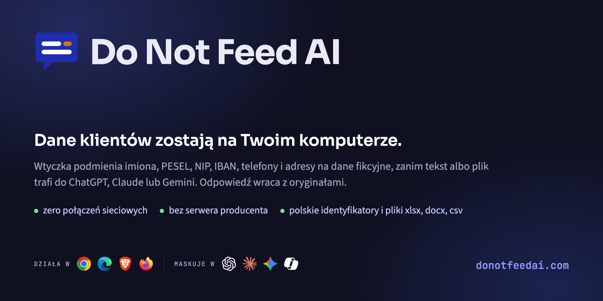

# Do Not Feed AI - pobieranie

**Polski** · [English](README.en.md)



Do Not Feed AI podmienia imiona, PESEL-e, numery telefonów, adresy i pliki na realistyczne dane fikcyjne,
**zanim opuszczą Twój komputer**. Odpowiedź modelu wraca już z prawdziwymi wartościami. Wszystko robi program
na Twoim komputerze, bez ani jednego połączenia z naszym serwerem, bo takiego serwera nie ma.

Do Not Feed AI to **program na komputer** (Windows, macOS) i **wtyczka do przeglądarki**, potrzebne razem:
program wykrywa i podmienia dane, wtyczka przekazuje mu to, co wysyłasz do czatu. Działa z licencją; okres próbny
to licencja z krótką datą, wysyłana na prośbę ([kontakt@donotfeedai.pl](mailto:kontakt@donotfeedai.pl)).

To repozytorium służy **tylko do dystrybucji**: instalator programu i wtyczka do przeglądarki.
Kod źródłowy nie jest tu publikowany. Oprogramowanie jest własnościowe, wszelkie prawa zastrzeżone;
warunki korzystania określa umowa licencyjna (OWU) przekazywana razem z licencją.

**zero połączeń sieciowych** · **polskie identyfikatory: PESEL, NIP, REGON, IBAN** · **xlsx, docx, csv, txt**

<p><b>Działa w:</b>
 Chrome &nbsp;
 Edge &nbsp;
 Brave &nbsp;
 Chromium i pochodne &nbsp;
 Firefox <code>w przygotowaniu</code></p>

<p><b>Maskuje w:</b>
<picture><source media="(prefers-color-scheme: dark)" srcset="assets/chats/chatgpt-dark.svg"></picture> ChatGPT &nbsp;
 Claude &nbsp;
 Gemini &nbsp;
<picture><source media="(prefers-color-scheme: dark)" srcset="assets/chats/copilot-dark.svg"></picture> Copilot</p>

<p><b>Systemy:</b>
 macOS &nbsp;
 Windows &nbsp;
 Linux <code>w przygotowaniu</code></p>

Strona: [donotfeedai.com](https://donotfeedai.com) · Polityka prywatności: [donotfeedai.com/polityka-prywatnosci.html](https://donotfeedai.com/polityka-prywatnosci.html)

## Co pobrać

Linki `latest/download/...` zawsze prowadzą do najnowszej wersji - nie trzeba ich zmieniać.
Wszystkie wydania (z numerami wersji i opisem zmian):
[github.com/donotfeedai/download/releases](https://github.com/donotfeedai/download/releases).

| plik | dla kogo |
|---|---|
| **[donotfeedai-macos.pkg](https://github.com/donotfeedai/download/releases/latest/download/donotfeedai-macos.pkg)** | **macOS** - program: instalator podpisany i notaryzowany, Gatekeeper nie będzie ostrzegał |
| **[donotfeedai-windows-setup.exe](https://github.com/donotfeedai/download/releases/latest/download/donotfeedai-windows-setup.exe)** | **Windows 10/11** - program i wtyczka: instalator na koncie użytkownika, bez uprawnień administratora. Podpisany cyfrowo (certyfikat wydany przez Microsoft), wydawca: Sebastian Obara It&Consulting |
| **[donotfeedai-wtyczka-chrome.zip](https://github.com/donotfeedai/download/releases/latest/download/donotfeedai-wtyczka-chrome.zip)** | **Chrome, Edge, Brave, Chromium** - wtyczka do załadowania jako rozpakowana |
| **[donotfeedai-wtyczka-firefox.zip](https://github.com/donotfeedai/download/releases/latest/download/donotfeedai-wtyczka-firefox.zip)** | **Firefox** - ta sama wtyczka, inny manifest |
| **[SHA256SUMS.txt](https://github.com/donotfeedai/download/releases/latest/download/SHA256SUMS.txt)** | sumy kontrolne pobranych plików |

**Potrzebne są oba: program i wtyczka.** Bez programu wtyczka nie maskuje danych - mówi to na pasku w czacie
i przed każdym wysłaniem pyta, czy wysłać wiadomość bez maskowania.

## Jak to działa



*Oryginalne wartości nigdy nie przekraczają granicy komputera. Mapa zamienników jest w programie, osobno dla każdej karty czatu, i znika z jej zamknięciem.*

- **Tekst w czacie**: piszesz normalnie, a wysyłkę przejmuje wtyczka - program wykrywa dane, wtyczka podmienia je w polu, wysyła zamienniki,
  a w odpowiedzi modelu przywraca oryginały. Z ekranu nie znikasz: dane, które widzisz, są prawdziwe.
- **Plik**: dodajesz xlsx, docx, csv albo txt jak zwykle. Wtyczka zatrzymuje wysyłkę, program maskuje plik na
  Twoim komputerze i do czatu trafia wersja `plik_anon.xlsx`. Formuły, style i formatowanie zostają nietknięte.
- **Sekrety i konfiguracje**: hasła, tokeny i klucze podmienia program, także w plikach `.env`,
  `docker-compose.yml` i logach.

## Co wykrywa

| dana | jak |
|---|---|
| imię i nazwisko | także w przypadkach zależnych: „dla Magdaleny”, „do Kowalskiego”; zamiennik wraca w tym samym przypadku |
| PESEL | suma kontrolna albo wiarygodna data urodzenia |
| NIP, REGON, IBAN, nr dowodu | z walidacją sum kontrolnych, więc numer zamówienia nie jest NIP-em |
| telefon i e-mail | e-mail we wzorcu osoby: `s.obara@` → `s.zalewski@`; numery 9-cyfrowe, z `+48`, myślnikami i spacjami |
| adres, kod i miasto | „ul. Długa 7” obok innych danych osobowych |
| firma | Sp. z o.o., S.A., Sp. j., Ltd., GmbH |
| własne frazy | nazwy projektów, klientów, produktów; w Business także słownik firmowy w pliku licencji |
| dane techniczne | sekrety, hasła, klucze i tokeny dostawców, hosty, adresy IP, loginy, adresy MAC |
| kolumny w arkuszach | nagłówek „Nazwisko” czy „PESEL” ustala typ całej kolumny |

Zamienniki są spójne w rozmowie: „Jan Kowalski” w arkuszu i w czacie tej samej karty dostaje ten sam zamiennik.
W innej karcie ta sama osoba dostaje inny zamiennik, więc dostawca AI nie powiąże rozmów.
Dwa tryby do wyboru: **dane fikcyjne** (domyślnie - tekst czyta się jak zwykłe pismo) albo **etykiety**
`[PERSON_1]`, `[PESEL_1]` do kodu i konfiguracji.

## Pliki

| format | co zostaje zachowane |
|---|---|
| XLSX | arkusze Excel, formuły |
| DOCX | akapity, tabele, nagłówki i stopki |
| CSV | separator: średnik, przecinek albo tabulator |
| TXT | txt, md, log |
| konfiguracje i logi | env, yaml, json, toml, ini, conf, properties, tf, sh, ps1, xml, sql, pem, key, Dockerfile, kubeconfig |
| PDF, obrazy | blokowane domyślnie - nic nie prześlizgnie się obok |

Z włączonym podglądem zobaczysz listę wykrytych wartości z licznikami - odznaczone zostają w pliku bez zmian.

## Prywatność i bezpieczeństwo

- **Nie ma serwera producenta.** Żadnej telemetrii, statystyk użycia, kont użytkowników ani sprawdzania
  licencji online. Wykrywanie i podmiana danych odbywają się na Twoim urządzeniu.
- **Jedyny ruch sieciowy** to opcjonalne „sprawdź aktualizacje”: po kliknięciu wtyczka pobiera jeden statyczny
  plik, bez parametrów, bez numeru wersji i bez identyfikatorów - porównanie wersji robi lokalnie.
  Żadnych żądań sieciowych w tle ani cyklicznie.
- **Mapa zamienników** jest w pamięci programu, osobno dla każdej karty czatu, i znika z jej zamknięciem.
  Przeglądarka jej nie przechowuje, więc ani strona czatu, ani inna wtyczka jej nie odczyta. Na wypadek zerwania
  połączenia program trzyma zaszyfrowaną kopię mapy otwartej karty (XChaCha20-Poly1305, klucz w Keychain na macOS
  albo w Credential Manager na Windows), bez haseł i kluczy API; kopia znika z zamknięciem karty, przy ponownym
  uruchomieniu przeglądarki i najpóźniej po 24 godzinach. Karty incognito nigdy nie trafiają na dysk.
- **Program nie zapisuje kopii roboczych plików** - przetwarza je w pamięci.
- **Licencja** to podpisany plik sprawdzany lokalnie przez program; nic nie jest wysyłane.
- Wtyczka ma uprawnienia tylko do pamięci lokalnej, komunikacji z programem i stron czatów, na których działa.

## Jak zainstalować

Skrót (pełna wersja: [INSTALACJA.md](INSTALACJA.md)):

1. **Program**: na macOS otwórz `donotfeedai-macos.pkg` i przejdź instalator (poprosi o hasło administratora,
   bo instaluje program w `/Applications`). Na Windows uruchom `donotfeedai-windows-setup.exe` (bez uprawnień
   administratora; o podpisie i SmartScreen - patrz [INSTALACJA.md](INSTALACJA.md#windows)).
2. **Wtyczka**: rozpakuj `donotfeedai-wtyczka-chrome.zip` (albo `-firefox.zip`), wejdź w `chrome://extensions`
   (Firefox: `about:debugging#/runtime/this-firefox`), włącz tryb dewelopera i wskaż rozpakowany folder.
3. **Zamknij i uruchom przeglądarkę ponownie.** W panelu wtyczki ma być `Program: połączony`.
4. **Licencja**: w panelu wtyczki, w sekcji Licencja, wczytaj plik `.lic`. Bez licencji ochrona jest wyłączona
   (czerwony pasek w czacie); licencję próbną wyślemy na prośbę.

| system | wtyczka | program |
|---|---|---|
| macOS | Chrome/Edge/Brave/Firefox + load unpacked | `donotfeedai-macos.pkg` |
| Windows | w instalatorze (Chrome/Edge/Brave/Firefox + load unpacked) | `donotfeedai-windows-setup.exe` (podpisany cyfrowo) |
| Linux | Chromium/Firefox + load unpacked | w przygotowaniu - bez programu wtyczka nie maskuje danych |

## Poziomy

| | Okres próbny | Pro | Business |
|---|---|---|---|
| kto | na prośbę, bez zobowiązań | na stanowisko, praca na danych klientów | na firmę, wdrożenie bez klikania |
| tekst, pliki, dane techniczne, przywracanie odpowiedzi | tak | tak | tak |
| własne frazy, tryb ręczny | tak | tak | tak |
| ważność | krótka | według umowy | według umowy |
| licencja | plik na stanowisko | plik na stanowisko | jeden plik na firmę, przez MDM lub politykę |
| wspólny słownik firmowy (klienci, projekty, produkty) | - | - | tak |

Licencja jest sprawdzana lokalnie przez program i nie wymaga połączenia z siecią. Bez licencji ochrona jest
wyłączona: wtyczka nie zmienia wiadomości ani plików, a czerwony pasek w czacie mówi to wprost.

## Weryfikacja pobrania

Sumy kontrolne są w każdym wydaniu (`SHA256SUMS.txt`), a te same wartości są wypisane w opisie wydania.
W rozpakowanym katalogu z pobranymi plikami:

```
shasum -a 256 -c SHA256SUMS.txt        # macOS, Linux
Get-FileHash .\donotfeedai-windows-setup.exe     # Windows (PowerShell), pojedynczo
```

Instalator macOS jest podpisany certyfikatem Developer ID i notaryzowany przez Apple; możesz to sprawdzić sam:

```
pkgutil --check-signature donotfeedai-macos.pkg
spctl -a -vv --type install donotfeedai-macos.pkg
```

Instalator Windows i programy w nim są podpisane certyfikatem wydanym przez Microsoft (Artifact Signing) dla
*Sebastian Obara It&Consulting*, ze znacznikiem czasu. W PowerShell:

```
Get-AuthenticodeSignature .\donotfeedai-windows-setup.exe | Format-List Status, SignerCertificate
```

## Aktualizacja

- **Program**: pobierz nowy instalator z najnowszego wydania i zainstaluj - nadpisuje poprzednią wersję.
  Program i wtyczkę aktualizuj razem: wtyczka nie współpracuje ze starszym programem i mówi to wprost.
- **Wtyczka** (załadowana jako rozpakowana): skopiuj zawartość nowego folderu do starego (nadpisując pliki)
  albo wskaż nowy folder w „Załaduj rozpakowane”, a potem kliknij odświeżenie w `chrome://extensions`
  i odśwież karty czatu. Ustawienia i licencja zostają - identyfikator wtyczki jest stały.
  Szczegóły: [INSTALACJA.md](INSTALACJA.md#aktualizacja).
- Wersję widać w panelu wtyczki: linia z wersją wtyczki i programu. Gdy wersje się rozjadą, wtyczka to zgłosi.

## Pytania, które padają najczęściej

**Czy muszę instalować program?**
Tak. Wykrywanie, zamienniki, przywracanie odpowiedzi i licencja są w programie, a wtyczka tylko przekazuje mu
tekst i pliki. Bez programu wtyczka nie maskuje danych. Program nie ma okna; działa, gdy przeglądarka jest otwarta.

**Co z danymi, których wtyczka nie wykryje?**
Nazwy projektów, klientów czy produktów dodajesz jako własne frazy. Podgląd przed wysłaniem pokazuje listę
wykrytych wartości z checkboxami, a tryb ręcznego przywracania pokazuje dokładnie to, co dostało i odpowiedziało
AI. Znane ograniczenie: nieznana wcześniej osoba wspomniana wyłącznie w przypadku zależnym („list do Nowaka”)
nie jest wykrywana.

**Czy wtyczka spowalnia pisanie albo wysyłanie?**
Program to reguły i sumy kontrolne, bez modeli językowych i bez chmury: kilka tysięcy znaków sprawdza w kilka
milisekund, więc licznik „N wykrytych” odświeża się
na bieżąco podczas pisania. Podmiana w polu następuje w chwili wysłania.

**Co się dzieje po wygaśnięciu licencji?**
Po dacie wygaśnięcia masz jeszcze 14 dni pełnego dostępu (okres przejściowy, z ostrzeżeniem w panelu i na pasku).
Potem ochrona jest wyłączona: wtyczka nie zmienia wiadomości ani plików, a czerwony pasek w czacie mówi to wprost.
Tak samo kończy się licencja próbna.
